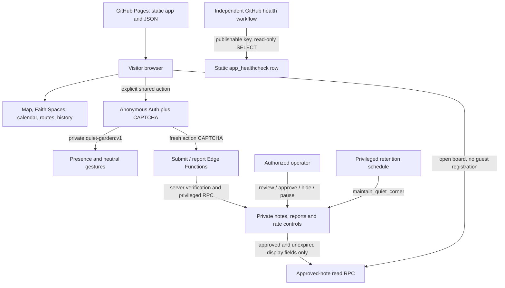

# Architecture

Taipei Faith Map is a static React/Vite application hosted on GitHub Pages at `/taipei-faith-map/`. Its map, cultural scenes, calendar, routes and history work without Supabase. Optional shared features are separate, gated services; source being merged does not mean they are activated.

## Static frontend

`App` retains map state while lazy-loaded cultural views and dialogs open. Generated registration JSON is separate from manually sourced cultural content. Profile and related-content links require safe identity matches; source dates and editorial review status remain visible. The app does not infer attendance, belief or historical boundaries from registration data.

Faith Moments is a decorative original SVG visitor controlled by brief, cancellable actions. Cultural text appears immediately. The locally stored motion setting is independent of the shared-service flags, and device reduced-motion takes precedence. There is no compulsory onboarding.

The Supabase SDK is dynamically imported only when an optional shared operation needs it. Displaying the ordinary map does not start Auth or Realtime. Build-time flags are independent:

- `VITE_FAITH_MOMENTS_ENABLED`: solo visitor layer, on by default.
- `VITE_QUIET_PRESENCE_ENABLED`: private shared garden, off by default.
- `VITE_QUIET_CORNER_ENABLED`: approved-note board, off by default.

Only public project configuration belongs in `VITE_` variables. Build validation rejects privileged credential patterns. The repository's Pages workflow explicitly keeps both shared flags false.

## Anonymous companionship

A visitor deliberately joins the one neutral garden. Supabase anonymous Auth creates an internal Auth user, using the `authenticated` role and `is_anonymous` claim; the publishable key alone is not a visitor identity. The client verifies the user with Auth, keeps the session only in page memory and does not enable persistent storage or automatic refresh. Anonymous Auth rows still exist server-side and require a reviewed operator retention policy.

Private Realtime policies authorize Presence/Broadcast only on `quiet-garden:v1` for anonymous Auth guests. Client payloads allow temporary random visitor keys, visual variants, poses/seats and bounded neutral gestures. They exclude Auth IDs, selected religions/organizations, coordinates and reading history. Payload keys are not authenticated public identities; broadcast greetings are presented without attribution.

There are no position-streaming timers or conventional chat. Leaving, closing or backgrounding ends this visit's channel and retries. Temporary failures have bounded recovery; foreground return after a background pause requires explicit entry. None of these failures blocks the map.

## Approved notes and private moderation

The browser reads at most 15 approved, unexpired notes through `get_approved_quiet_notes`. The response contains only display fields: ID, content and expiry. Reading does not require guest creation or a submission CAPTCHA. Raw notes, reports, rate counters and settings are inaccessible to public and anonymous-Auth roles.

Submissions and reports go through Edge Functions. The functions verify the Auth user and anonymous claim, exact request origin, an action-specific CAPTCHA and a bounded schema before using privileged mutation RPCs. Notes are normalized and limited to 80 grapheme clusters and 1024 UTF-8 bytes. The database serializes per-actor rate controls and duplicate checks. Every submission is pending; the client cannot approve it.

An authorized operator reviews notes and reports privately in Supabase Dashboard/SQL. Approval, hiding and deletion use privileged procedures. `posting_enabled=false` stops new submissions immediately without a frontend rebuild; it does not hide existing approved notes. Retention is handled by the narrow `maintain_quiet_corner()` procedure under a privileged, observable schedule. It is independent of the public health read and does not delete Auth users or unrelated application data.

## Deployment, failure and rollback

GitHub Pages publishes the Vite build for the repository subpath. The manifest, service-worker scope and public-asset URLs must resolve within that subpath. PWA cache behavior and actual browser/offline evidence are recorded in the current release notes; this architecture is not a promise that every lazy view or external map tile works offline.

The existing independent GitHub Actions workflow runs a bounded read-only query of `app_healthcheck` on schedule and manual dispatch. It uses only the project URL and publishable key. It does not deploy the frontend, create guests, moderate notes or run retention. A successful health read proves that narrow query at that time, not Auth, Realtime, Edge readiness or continuous availability.

If shared services fail, visitors can leave and continue solo exploration. Operators can pause posting at the database, hide content, or disable the shared UI with a new build. A frontend rollback does not reverse database migrations; use reviewed additive changes or a reviewed restoration procedure. Free-tier pausing and scheduler delays remain possible, and there is no guaranteed uptime SLA.

See [controlled activation](public-launch-checklist.md), [Supabase integration](supabase-integration.md), [moderation](quiet-corner-moderation.md) and [health monitoring](supabase-health-check.md) for procedures and evidence boundaries.

## V2.1 discovery and monthly maintenance

Routes link to validated stories through a shared current-place identity. Story detours retain the reading context and a route return restores the selected stop and focus. Initial map rendering still defers the route, heritage and optional shared modules. Opening routes can load the heritage lookup to discover related stories.

A dedicated monthly Actions workflow runs editorial audits and compares official government data to the reviewed JSON. Its report and tracking issue are review inputs for the owner. The workflow has no content publishing or deployment step. The Pages deployment, retention job and health workflow operate independently. See [monthly maintenance](monthly-content-maintenance.md).
